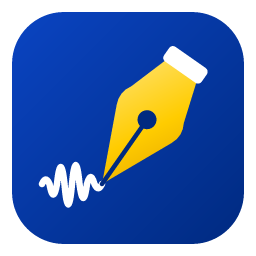

<p align="center">
  
</p>

<h1 align="center">Kalam</h1>

<p align="center">
  <a href="https://github.com/abrarsyedx/kalam/actions/workflows/windows.yml"></a>
  <a href="https://github.com/abrarsyedx/kalam/actions/workflows/macos-apple-silicon.yml"></a>
  <a href="https://github.com/abrarsyedx/kalam/actions/workflows/macos-intel.yml"></a>
</p>

<p align="center"><b>Offline meeting recorder &amp; live transcriber for Windows and macOS.</b><br>
Records your microphone and your computer's audio (Microsoft Teams, Zoom, Google Meet, any app or browser tab),
saves it as <b>MP3</b>, and writes a live transcript that is saved as a <b>Word (.docx)</b> document.
Everything runs on your device. No account, no cloud, no internet connection.</p>

*Kalam* means **pen**: it writes down what it hears.

---

## Features

- **Record and transcribe with one click.** **Record / Pause / Stop** buttons, a running timer and live level meters for the microphone and the computer's audio. Click the microphone or speaker icon to **mute** that source mid-recording.
- **Captures meeting audio without extra drivers.**
  - Windows 10/11: WASAPI loopback, so whatever the PC plays is recorded.
  - macOS 14.6+: a Core Audio process tap, so no BlackHole or Soundflower is needed.
- **Real-time, offline transcription** with OpenAI's Whisper, run locally by [whisper.cpp](https://github.com/ggml-org/whisper.cpp). The text appears while people speak (grey preview) and is finalised a moment after each pause.
- **Uses your graphics card (GPU) when it helps, and falls back to the processor safely.** Vulkan on Windows covers Intel, AMD and NVIDIA graphics; Metal covers every Mac. On a Core Ultra 7 laptop the integrated Intel Arc graphics made speech recognition **5–10× faster**. A PC with no usable graphics simply uses the CPU (see [How Kalam stays safe on any PC](#how-kalam-stays-safe-on-any-pc)).
- **Polished transcript after the meeting.** When you press Stop, Kalam re-transcribes the whole recording more carefully (full context, beam search) and updates the `.docx`. Sentences the live pass had to cut are joined back together.
- **Names & terms.** Tell Kalam the people, companies and jargon that come up in your meetings, and the speech model spells them your way.
- **Two speech models built in; switch with one click** from the menu at the top of the window (or in Settings):

  | | Model | Size | Languages | Best for |
  |---|---|---|---|---|
  | **Accurate** (default) | Whisper Large-v3 Turbo | 574 MB | English and all EU languages (99 in total) | Highest accuracy: names, accents, fast or noisy speech |
  | **Fast** | Whisper Small | 190 MB | English | Older PCs without usable graphics |

  You can also load any other whisper.cpp model file (**Custom**).
- **Speaker labels by voice: Speaker 1, Speaker 2, …** Kalam recognises voices and labels who said what, offline.
  - Labels appear live as people speak.
  - After Stop, Kalam compares every voice in the recording and corrects them.
  - Each speaker gets their own colour on screen and in the `.docx`.
  - You can tell Kalam how many people are in the meeting, or let it work it out.
  - The older **You / Others** labelling (microphone vs computer audio) is still available.
- **Files saved automatically** into a folder you choose: `Kalam_2026-10-16_09-30-00.mp3` and `Kalam_2026-10-16_09-30-00.docx`. The transcript is re-saved after every sentence, so a crash or power cut loses almost nothing.
- **Blue & yellow design** with light and dark themes that follow the system.
- **Open source (MIT)** and one code base: Rust core plus a web UI via [Tauri 2](https://tauri.app).

### Why Whisper and not a general LLM?

Speech-to-text is a dedicated task. Whisper is a speech recognition model, an encoder-decoder transformer trained on 680,000 hours of audio (5 million hours for Large-v3). It is far more accurate per megabyte and per CPU cycle than a chat-style LLM.

### Measured on a Core Ultra 7 155H laptop

Fast-talking test clip (OpenAI's *Micro Machines* advert, 30 s). Processing time per second of audio:

| | Graphics card (Intel Arc, Vulkan) | Processor only |
|---|---|---|
| Accurate, live text | **0.11 s** | 0.59 s |
| Fast, live text | 0.10 s | 0.23 s |
| Polishing after Stop (Accurate) | **0.23 s** | about 1.5 s |

Accuracy on the same clip:
- **Accurate** gets it word-perfect, e.g. "…motorcade of Micro Machines… **you'll want** to pocket them all… the smaller they are, the better they are."
- **Fast** writes "Motocade of Micro Machine", and in one pass it dropped the last sentence.

### Accuracy on a real meeting

A 5-minute excerpt of a real English meeting (3 speakers, non-native accents, many acronyms and names), streamed through Kalam in real time on the graphics card. It was scored against a transcript corrected by a person. WER is the word error rate (lower is better). It ignores "uh"/"um" and stutters such as "in, in, in".

| | Live text | After polishing | Speaker labels after Stop* |
|---|---|---|---|
| Accurate | 7.0 % | 6.3 % | 98.9 % |
| Accurate + **Names & terms** | 5.9 % | **4.7 %** | 99.9 % |
| Fast | 13.4 % | 9.4 % | 95.5 % |

\* Share of words attributed to the right speaker; all three speakers were found every time. Live labels are about as accurate but sometimes give a short reply a new number. Polishing takes about 45 s for the 5 minutes on the graphics card.

- **Most remaining errors are names and acronyms**: people's names, organisations' acronyms and product names written as similar-sounding words. That is exactly what **Settings → Names & terms** fixes; listing them cut the errors by a quarter.
- **NVIDIA Parakeet-TDT 0.6B v3**, a newer non-Whisper model, was tested on the same excerpt: **14.9 %** WER, no faster on the processor, and its "hotwords" (its version of names & terms) made it worse. So Kalam stays with Whisper.

---

## Install (end users)

Download the installer for your system from the project's **Releases** page, or from the **Actions** tab (see [Building installers on GitHub](#building-installers-on-github)).

### Windows 10 / 11

| File | When to use |
|---|---|
| `Kalam_1.4.0_x64-setup.exe` | **Recommended.** Installs for the current user, no admin rights needed. |
| `Kalam_1.4.0_x64_en-US.msi` | For IT departments / Group Policy deployment. |

1. Run the installer. The app isn't code-signed, so Windows SmartScreen may say *"Windows protected your PC"*. Click **More info → Run anyway**.
2. Start **Kalam** from the Start menu.
3. **The first start takes about 30 seconds longer:** Kalam tests your graphics card once (the badge next to the model name shows **…**, then **GPU** or **CPU**).
4. Windows may ask for microphone access the first time. Allow it. If recording the microphone fails, check **Settings → Privacy & security → Microphone → "Let desktop apps access your microphone"**.

Requirements: a 64-bit CPU with AVX2 (any Intel Core from 2013 / AMD Ryzen or newer), ~1 GB of disk space, and 8 GB RAM for the Accurate model (4 GB is enough with Fast). Any graphics with an up-to-date driver speeds things up a lot; without one, use a recent 4-core CPU for Accurate, or choose Fast. WebView2 is built into Windows 11; on Windows 10 the installer fetches it if missing.

### macOS 14.2+ (Apple Silicon or Intel)

1. Open `Kalam_1.4.0_aarch64.dmg` (Apple Silicon) or `Kalam_1.4.0_x64.dmg` (Intel) and drag **Kalam** to **Applications**.
2. The app isn't notarised by Apple. The first time, open it, then go to **System Settings → Privacy & Security** and click **Open Anyway**. Or run this in Terminal:
   ```bash
   xattr -dr com.apple.quarantine /Applications/Kalam.app
   ```
3. On the first recording macOS asks for **Microphone** and **System Audio Recording** permission. Allow both. You can change them later under **System Settings → Privacy & Security**.

System-audio capture needs **macOS 14.6 or newer**. On 14.2–14.5 Kalam records the microphone only.

---

## Using Kalam

1. Click **Record**. Kalam starts capturing the microphone and the computer's audio and begins writing.
2. **Pause** stops both recording and transcription. **Resume** continues in the same files.
   - **Mute one source:** while recording, click the **microphone** or **speaker** icon next to its level meter. A muted source turns red and is left out of the MP3 and the transcript (it is silent there), while the other keeps recording. Click again to unmute.
   - **Scrolled up to reread something?** The live text stops following, and a **Latest** button appears at the bottom left. Click it to jump back to the newest text.
3. **Stop** finishes the MP3 and saves the `.docx` right away. If polishing is on, the footer then shows **Polishing transcript… %**. When it finishes, the polished text replaces the live text on screen and in the `.docx`. Click **Skip** to keep the live version; starting a new recording also skips it.
4. **Switch speech models** with the menu at the top right. The dot is green when the model is ready. The **GPU**/**CPU** badge shows where speech recognition runs. The menu is disabled while recording.
5. **Settings** (gear icon, or `Ctrl+,` / `Cmd+,`): save folder, devices, model, language, names & terms, polishing, graphics card and more.

**Tips for meetings**

- **Use headphones if you can.** With laptop speakers, the microphone also picks up the other people's voices, so the recording contains them twice. That blurs the voices for speaker labelling and the You/Others labels.
- **Speaker labels work best when** people take turns and speak for a few seconds at a time. Short replies ("yes", "mm-hm") take the label of the speech around them. When two people talk at once, the line goes to whoever is louder.
- If you know how many people will talk, set **Settings → Number of speakers**. If one person keeps getting two labels, or two people share one, that fixes it.
- In **Settings → Computer audio**, pick the device your meeting app plays through (e.g. your headset), or leave it on *System default*.
- Put recurring **names & terms** in Settings, e.g. `Maria Rossi, ACME GmbH, Kubernetes, Q3 roadmap`.
- For a meeting in another language, set **Settings → Language**: English first, then all EU languages (Bulgarian … Swedish), or *Detect automatically*. This needs the Accurate model.
- If the final text falls far behind the grey preview, plug in the charger, check that the badge says **GPU**, or switch to **Fast**.
- Recording other people may require their consent where you live. Let participants know you are recording.

---

## How Kalam stays safe on any PC

GPU drivers vary a lot between PCs, so Kalam never relies on one blindly:

1. **It always starts.** The installer includes the Vulkan loader (`vulkan-1.dll`, from Khronos/LunarG). Kalam therefore launches even on PCs with no graphics driver at all, such as virtual machines or Windows Server.
2. **The GPU is tested first, in a separate process.** On first start (and after each Kalam update), a throw-away copy of Kalam (`kalam --gpu-probe`) loads a model and transcribes a test clip on the GPU *and* on the CPU.
   - A driver that crashes or hangs only takes down that test process.
   - Kalam uses the GPU only if it is clearly faster (at least 20 %).
   - The verdict is cached in `gpu.json` next to the settings.
3. **In CPU mode, graphics drivers are kept out entirely.** Kalam tells its Vulkan loader not to load any driver, so a broken driver can't affect it.
4. **Crash marker.** Each model is loaded and warmed up on the GPU behind a marker file. If Kalam ever dies at that moment, the next start uses the CPU and says so.
5. **Graphics work runs one task at a time** to avoid driver race conditions.
6. **You stay in control:** **Settings → Graphics card** shows the result, can switch the GPU **off**, and has **Test graphics card again** (e.g. after a driver update).

---

## How it works

```
 Microphone ──► cpal input stream ─┐                         ┌─► LAME ─► .mp3   (streamed to disk)
                                   ├─► mixer (48 kHz mono) ──┤
 Computer audio ─► loopback/tap  ──┘   jitter buffers,       └─► 16 kHz ─► VAD ─► Whisper (GPU or CPU) ─► live UI + .docx
  (WASAPI / Core Audio tap)            level meters                                   │
                                                                     after Stop ──► polish pass ──► .docx (polished)
```

- **Capture** (`src-tauri/src/audio/capture.rs`): [cpal](https://github.com/RustAudio/cpal). System audio is an *input* stream opened on an *output* device. cpal maps that to WASAPI loopback (Windows) or a Core Audio process tap plus aggregate device (macOS 14.6+).
- **Mixer** (`audio/mixer.rs`): converts both sources to 48 kHz mono and gives each a small jitter buffer. It is paced by the wall clock, because Windows loopback sends no data during silence. Output goes to the MP3 encoder and, downsampled to 16 kHz, to the transcriber.
- **Live transcription** (`transcribe.rs`):
  - A voice-activity detector splits speech into utterances at natural pauses, or at the quietest moment every 15 s during non-stop speech.
  - The utterance in progress is previewed about once a second (by the Fast model when Accurate is selected), then transcribed properly once the speaker pauses.
  - Silence is never sent to Whisper, which avoids its well-known *"Thank you."* hallucinations.
  - Your names & terms go into Whisper's prompt.
- **Polishing** (`transcribe.rs`): after Stop, the session's speech is re-transcribed in windows of up to 28 s that are split at the quietest moments. It uses beam search, the full 30-second encoder context and the previous text as context. A safety check keeps the live transcript if the polished one looks incomplete.
- **Speaker labels** (`speakers.rs`): a voiceprint model (NVIDIA TitaNet-small, 40 MB, run by [sherpa-onnx](https://github.com/k2-fsa/sherpa-onnx)) turns a few seconds of speech into a "voiceprint" that is similar for the same voice and different for different voices.
  - **Live:** each finished sentence's voiceprint is compared with the voices heard so far; a new voice becomes a new speaker.
  - **After Stop:** the recording is cut into short utterances at pauses, each gets a voiceprint, and all of them are grouped at once. Tiny groups (a cough, a laugh) are folded into the closest real speaker, and speakers are numbered in order of appearance.
  - **Why this pipeline:** on a real 66-minute meeting with 4 participants it found 4 speakers at every similarity setting tested (0.40–0.65), in 0.03× the meeting's length on the CPU. pyannote's full segmentation pipeline found 9–17 "speakers" on the same audio and was up to 20× slower, so Kalam doesn't use it.
- **GPU** (`gpu.rs`): detection, the isolated probe, caching, and the safety layers described above.
- **Documents** (`docx.rs`): [docx-rs](https://github.com/bokuweb/docx-rs). Consecutive sentences from the same speaker are merged into one paragraph with a timestamp. The header notes whether the text is live or polished.

---

## Build from source

### 1. Install the prerequisites

**Windows 10/11.** Run these in PowerShell (accept the UAC prompts):

```powershell
winget install -e --id Rustlang.Rustup
winget install -e --id OpenJS.NodeJS.LTS
winget install -e --id Kitware.CMake
winget install -e --id Ninja-build.Ninja
winget install -e --id Git.Git
winget install -e --id LLVM.LLVM
winget install -e --id KhronosGroup.VulkanSDK
winget install -e --id Microsoft.VisualStudio.2022.BuildTools --override "--wait --passive --add Microsoft.VisualStudio.Workload.VCTools --includeRecommended"
```

Then open a **new** terminal so the updated `PATH` is picked up, and check:

```powershell
rustc --version; node --version; cmake --version; ninja --version; $env:VULKAN_SDK
```

**macOS 14+** (Metal needs no extra SDK):

```bash
xcode-select --install                                         # Apple's compilers
/bin/bash -c "$(curl -fsSL https://raw.githubusercontent.com/Homebrew/install/HEAD/install.sh)"   # if you don't have Homebrew
brew install cmake node
curl --proto '=https' --tlsv1.2 -sSf https://sh.rustup.rs | sh
```

### 2. Get the code and dependencies

```bash
git clone https://github.com/<your-account>/kalam.git
cd kalam
npm install
```

The two Whisper models (574 MB + 190 MB), the voiceprint model (40 MB), the Vulkan loader and, on Windows, the sherpa-onnx/ONNX Runtime DLLs are kept out of git. **The first build downloads them automatically** into `src-tauri/resources/`. You can also fetch the models up front with `scripts/fetch-model.ps1` (Windows) or `scripts/fetch-model.sh` (macOS).

### 3. Build the installers

**Windows** (one command; it handles the Windows-specific details below):

```powershell
powershell -ExecutionPolicy Bypass -File scripts\build-windows.ps1
```

The installers are copied to `dist\`. On Windows the build output goes to a short folder (`C:\kt` by default; change it with `-TargetDir D:\kt`). whisper.cpp's Vulkan build creates deeply nested files, and Windows limits paths to 260 characters. `src-tauri/.cargo/config.toml` also makes CMake use Ninja instead of MSBuild on Windows for the same reason.

**macOS:**

```bash
npm run build
```

Output: `src-tauri/target/release/bundle/macos/Kalam.app` and `dmg/Kalam_1.4.0_<arch>.dmg`.

The first build compiles whisper.cpp (with its GPU shaders) and LAME from source, which takes 10–20 minutes; later builds take a minute or two.

### 4. Run in development mode

```powershell
$env:CARGO_TARGET_DIR = "C:\kt"     # Windows only: short build folder
npm run dev
```

### 5. Tests

```bash
cd src-tauri
cargo test --release                    # unit tests: resampler, text cleanup, prompts, polish windows, settings, .docx
```

Hardware and model tests need a speech recording in `KALAM_TEST_WAV`: a `.wav` or `.mp3`, e.g. [`jfk.wav`](https://github.com/ggml-org/whisper.cpp/raw/master/samples/jfk.wav), the fast-talking [`micro-machines.wav`](https://cdn.openai.com/whisper/draft-20220913a/micro-machines.wav), or one of your own meeting recordings. For a long recording, either:
- use `KALAM_TEST_START` and `KALAM_TEST_SECONDS` to test an excerpt, or
- cut the most speech-dense 1-minute and 5-minute stretches into WAV files once:
  ```bash
  KALAM_TEST_WAV=meeting.mp3 KALAM_CLIP_DIR=/some/folder cargo test --release extract_clips -- --ignored --nocapture
  ```

Optional variables:
- `KALAM_TEST_MODEL`: a model file (default: Fast).
- `KALAM_TEST_GPU=1`: run on the graphics card.
- `KALAM_TEST_POLISH=1`: include the polish pass.
- `KALAM_TEST_VOCAB="a, b"`: names & terms.
- `KALAM_TEST_SPEAKERS=voice` (and optionally `KALAM_TEST_EXPECTED_SPEAKERS=n`): speaker labels by voice.
- `KALAM_TEST_OUT=prefix` (`streams_wav`): save the live and polished transcripts as `prefix-live.txt` / `prefix-polished.txt` for scoring.

```bash
# Is the GPU usable, and how much faster is it? (Simulate "no graphics" with VK_LOADER_DRIVERS_DISABLE=*)
cargo test --release gpu_probe -- --ignored --nocapture
# Streams the WAV through the realtime transcriber, printing previews/finals (and polish) with timings
KALAM_TEST_WAV=jfk.wav cargo test --release streams_wav -- --ignored --nocapture
# Plays the WAV on your speakers and records it back: capture -> mixer -> MP3 -> Whisper
KALAM_TEST_WAV=jfk.wav cargo test --release loopback -- --ignored --nocapture
# A whole recording incl. pause/resume and polishing, in a mock app
KALAM_TEST_WAV=jfk.wav cargo test --release full_session -- --ignored --nocapture
# Does MP3 compression change the transcript? Clean WAV vs. 128 kbps MP3 round trip (KALAM_TEST_KBPS=64 for other rates)
KALAM_TEST_WAV=jfk.wav cargo test --release mp3_round_trip -- --ignored --nocapture
# Reference draft for accuracy scoring: Kalam's most careful transcript of an excerpt (.docx + .txt + .wav),
# for a person to correct. KALAM_TEST_START / KALAM_TEST_SECONDS choose the excerpt.
KALAM_TEST_WAV=meeting.mp3 KALAM_TEST_START=597 KALAM_TEST_SECONDS=300 KALAM_DRAFT_DIR=out cargo test --release reference_draft -- --ignored --nocapture
# ...then score any transcript (.txt or .docx) against the corrected draft: WER, speaker accuracy, and each error
node ../scripts/score-transcript.js out/reference-draft-<span>.docx out/run-polished.txt --edits
# Same excerpt through NVIDIA Parakeet-TDT (sherpa-onnx model folder in KALAM_PARAKEET_DIR), for comparison
KALAM_TEST_WAV=meeting.mp3 KALAM_TEST_START=597 KALAM_TEST_SECONDS=300 KALAM_PARAKEET_DIR=parakeet KALAM_TEST_OUT=parakeet.txt cargo test --release parakeet_bench -- --ignored --nocapture
# Speaker labels: how many speakers are found at each similarity setting, and how fast
KALAM_TEST_WAV=meeting.mp3 cargo test --release voiceprint_bench -- --ignored --nocapture
# Speed + output of models for each kind of pass (KALAM_TEST_MODELS="a.bin;b.bin", KALAM_TEST_THREADS=n)
KALAM_TEST_WAV=jfk.wav cargo test --release bench_models -- --ignored --nocapture
```

(In PowerShell, set variables first, e.g. `$env:KALAM_TEST_WAV = "C:\path\jfk.wav"`.)

---

## Building installers on GitHub

The workflows in `.github/workflows/` build **Windows x64** (`windows.yml`), **macOS Apple Silicon** (`macos-apple-silicon.yml`) and **macOS Intel** (`macos-intel.yml`) installers on GitHub's machines, each with its own status badge at the top of this README. They share their steps in `build.yml`, installing the Vulkan SDK and Ninja for Windows. You don't need a Mac to get the macOS version.

1. Create an empty repository on GitHub (e.g. `kalam`), then push:
   ```bash
   git init
   git add .
   git commit -m "Kalam 1.4.0"
   git branch -M main
   git remote add origin https://github.com/<your-account>/kalam.git
   git push -u origin main
   ```
2. Open the repository's **Actions** tab. When the *Windows*, *macOS (Apple Silicon)* and *macOS (Intel)* runs finish (~20–30 min), download the installers from each run's **Artifacts** section.
3. To publish a release, push a version tag. A **draft release** with all installers attached is created; review it and click **Publish**:
   ```bash
   git tag v1.4.0
   git push origin v1.4.0
   ```

---

## Configuration

Settings are saved as JSON at:

- Windows: `%APPDATA%\io.github.kalam.desktop\settings.json`
- macOS: `~/Library/Application Support/io.github.kalam.desktop/settings.json`

| Setting | Default | Notes |
|---|---|---|
| Save location | `Documents/Kalam` | Any folder you can write to. |
| Microphone / device | on / system default | |
| Computer audio / device | on / system default | Records the chosen output (speakers/headset). |
| Speech model | Accurate | *Accurate* (Large-v3 Turbo), *Fast* (Small.en) or *Custom* (any whisper.cpp `ggml-*.bin` file). Also switchable from the main window. |
| Language | English | English, all EU languages, others, or auto-detect (Accurate or a multilingual custom model). |
| Names & terms | empty | Comma-separated; up to ~400 characters are used. |
| Polish transcript after recording | Automatic | *Automatic* polishes when a GPU is in use (about ¼ of the meeting length); *Always* also on CPU (can take longer than the meeting); *Off*. |
| Graphics card | Automatic | *Automatic* uses the GPU if it passes Kalam's test; *Off* always uses the CPU. **Test graphics card again** re-runs the test. |
| CPU threads | Automatic | Fast: half your logical CPUs, at most 6. Accurate: ~55 % of them, at most 12. These were the fastest settings in testing; using every core is slower on laptops with efficiency cores. |
| Live preview | on | Turn off to save CPU on slow machines. |
| Speaker labels | By voice | *By voice* (Speaker 1, 2, … with the voiceprint model), *By audio source* (You = microphone / Others = computer audio, only when both are recorded) or *Off*. |
| Number of speakers | Automatic | With labels by voice: set 2–10 if you know it; Kalam then groups the voices into exactly that many speakers. |
| MP3 quality | 128 kbps mono | 64–256 kbps; ~58 MB per hour at 128 kbps. |

Logs (useful for bug reports): Windows `%LOCALAPPDATA%\io.github.kalam.desktop\logs`, macOS `~/Library/Logs/io.github.kalam.desktop`.

### Other models

Kalam ships with *Accurate* and *Fast*. To use another model, download it once from <https://huggingface.co/ggerganov/whisper.cpp/tree/main> and pick it under **Settings → Speech model → Custom model file**. After that, no internet is needed. Models over 300 MB automatically get the large-model treatment: more threads, a trimmed encoder window, and the Fast model for previews.

| Model file | Size | Languages | Notes |
|---|---|---|---|
| `ggml-base.en-q5_1.bin` | 57 MB | English | Fastest; for very old PCs. |
| `ggml-small.en-q5_1.bin` | 190 MB | English | **Bundled as Fast.** |
| `ggml-medium.en-q5_0.bin` | 539 MB | English | Between Fast and Accurate. |
| `ggml-large-v3-turbo-q5_0.bin` | 574 MB | 99 languages | **Bundled as Accurate (default).** |
| `ggml-large-v3-q5_0.bin` | 1.1 GB | 99 languages | Slightly more accurate than Turbo, ~4× slower; only with a capable GPU. |

### NVIDIA CUDA (optional)

Vulkan already uses NVIDIA cards. For CUDA instead (Windows/Linux, needs the CUDA Toolkit): `npm run build -- --features gpu-cuda`.

---

## Troubleshooting

| Problem | Fix |
|---|---|
| The badge says **CPU** although the PC has graphics | Update the graphics driver, then **Settings → Graphics card → Test graphics card again**. The status line explains why the GPU isn't used. |
| Kalam says it "closed unexpectedly while starting the graphics card" | The driver crashed once, so Kalam now uses the CPU. After a driver update, use **Test graphics card again**. |
| "System audio unavailable" on macOS | Needs macOS 14.6+. Allow **System Audio Recording** for Kalam in **System Settings → Privacy & Security**, then restart Kalam. |
| No meeting audio recorded (Windows) | In Settings, select the output device your meeting app actually uses (headset vs speakers). |
| Voices doubled / echo in the MP3 | The mic is picking up your speakers. Use headphones. |
| One person gets two speaker labels, or two people share one | Set **Settings → Number of speakers**. Labels after Stop are more reliable than the live ones. |
| Transcript lags behind | Check the **GPU** badge, plug in the charger (Windows throttles the CPU on battery), or switch to **Fast**. |
| Polishing takes very long | It's set to *Always* on a PC without a usable GPU. Use *Automatic*, or click **Skip**. |
| Microphone silent on Windows | **Settings → Privacy & security → Microphone →** allow desktop apps. |
| `.docx` could not be saved | Close the transcript in Word while recording. Kalam retries after every sentence. |
| Build: `LNK1104`, `MSB3491` or "path exceeds the OS max path limit" | Use `scripts\build-windows.ps1`, or set `CARGO_TARGET_DIR` to a short folder such as `C:\kt`. |
| Build: `CMake was unable to find a build program corresponding to "Ninja"` | `winget install Ninja-build.Ninja`, then open a new terminal. |
| Build: `Please install Vulkan SDK` | `winget install KhronosGroup.VulkanSDK`, then open a new terminal (it sets `VULKAN_SDK`). |
| Build: `Unable to find libclang` | Install LLVM (`winget install LLVM.LLVM`) and open a new terminal, or set `LIBCLANG_PATH=C:\Program Files\LLVM\bin`. |
| Build: very slow transcription after changing `src-tauri/.cargo/config.toml` | Cargo doesn't track those values. Run `cargo clean --release -p whisper-rs-sys` in `src-tauri`. |

---

## Platform notes

- **Windows and macOS** are fully supported.
- **Android** is not included. Android prevents all apps from capturing the call audio of Teams, Zoom or Meet (voice-call streams are excluded from `AudioPlaybackCapture`), so a phone could only record the microphone. The code base is Tauri 2, which can target Android, if microphone-only mobile recording is wanted later.
- **Linux** may well work (PulseAudio/PipeWire monitor sources appear as input devices) but isn't tested or packaged.

## Project layout

```
kalam/
├─ ui/                      Front end (plain HTML/CSS/JS, no build step)
├─ assets/kalam-icon.svg    Logo source; `npm run icons` regenerates all icon sizes
├─ scripts/                 Windows build script, model download helpers, transcript scorer
├─ .github/workflows/       CI: builds installers for Windows + macOS
└─ src-tauri/               Rust core (Tauri 2)
   ├─ src/audio/            capture (cpal), resampler, mixer, MP3 (LAME)
   ├─ src/transcribe.rs     Whisper models, realtime VAD/transcription, polish pass
   ├─ src/gpu.rs            GPU detection, isolated probe, CPU fallback
   ├─ src/speakers.rs       Speaker labels by voice (voiceprints + grouping)
   ├─ src/docx.rs           Word transcript writer
   ├─ src/session.rs        One recording: wires everything together
   ├─ src/commands.rs       Commands called by the UI
   ├─ .cargo/config.toml    whisper.cpp build flags (optimisation, portable CPU baseline, Ninja on Windows)
   ├─ tauri.conf.json       App / installer configuration
   └─ tauri.windows.conf.json  Windows extras (bundled Vulkan loader, sherpa-onnx DLLs)
```

## License

[MIT](LICENSE). Bundled third-party components (whisper.cpp, Whisper weights, LAME, the Vulkan loader, sherpa-onnx, ONNX Runtime, TitaNet, …) keep their own licenses; see [LICENSE](LICENSE).
